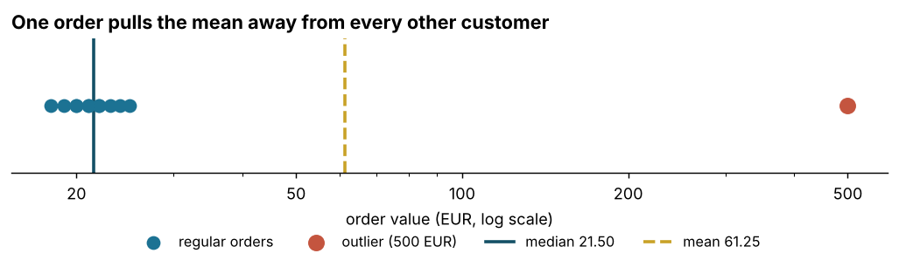

# Statistics Foundations — Which number is "the typical order"?

## Business Problem
A shop reports its *average order value* to management. Is the average a fair picture of a
typical customer, or can a single large order distort it?

---

## Dataset
`ecommerce_orders.csv` — **12 simulated orders** (order_id, customer_id, order_value in EUR).
Deliberately small, so every number below can be checked by hand.

---

## Methods
- Input validation (columns, unique ids, positive values)
- Mean vs. median, quartiles, standard deviation
- Outlier detection with Tukey's rule (1.5 × IQR)
- Effect of the outlier on each statistic; 10 % trimmed mean as a robust alternative

---

## Key Findings

| Finding | Number |
|---|---|
| Mean order value | 61.25 EUR |
| Median order value | 21.50 EUR |
| Orders above the mean | 1 of 12 |
| Revenue share of the single 500 EUR order | 68.0 % |
| Shift of the mean caused by that order | +186.7 % |
| Shift of the median caused by that order | +2.4 % |
| Upper outlier fence (Q3 + 1.5 × IQR) | 28.13 EUR |

- The **mean describes almost no customer**: only one order lies above it.
- The **median barely moves** when the outlier is removed — it is the robust "typical" value.
- **One order carries two thirds of revenue.** Whether it is a key account or a data error
  changes the business conclusion, so it needs a separate look, not silent removal.

---

## Business Recommendation
1. Report the **median** as the typical order value and show the mean next to it — the gap is a signal.
2. Report **large orders separately** instead of letting them shape the average.
3. **Look at the distribution before choosing a KPI.**

**Limits:** simulated data shows the mechanism, not a real shop. On real data the outlier rule
must be checked against domain knowledge (B2B orders, returns, test orders).

---

## Files

| File | Purpose |
|---|---|
| `01_statistics_foundations.ipynb` | The analysis, step by step, with outputs |
| `stats_foundations.py` | Calculation helpers used by the notebook and the tests |
| `tests/test_stats_foundations.py` | 7 hand-checkable tests (`python -m pytest tests -q`) |
| `figures/mean_vs_median.png` | The chart above, generated by the notebook |
| `ecommerce_orders.csv` | Input data |

---

## Tools
Python (pandas, matplotlib) · Jupyter Notebook · pytest
