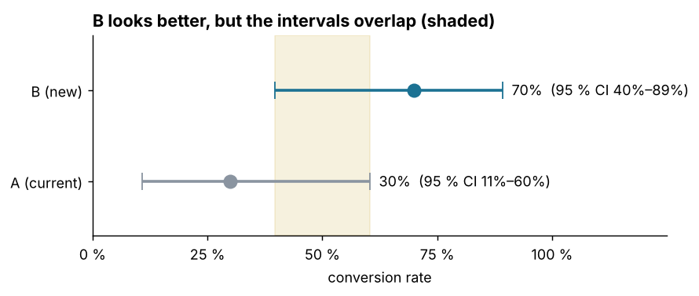

# A/B Testing — Is B really better than A?

## 🎯 Business Problem
A new landing page (B) was tested against the current one (A). B converted more users.
Should the team roll B out?

---

## 📊 Dataset
`ab_test.csv` — **20 simulated users**, 10 per group (user_id, group A/B, converted 0/1).

---

## 🧠 Methods
- Input validation (groups, binary outcome, unique users)
- Conversion rates with **Wilson** confidence intervals (reliable for small samples)
- **Fisher's exact test** (right for small samples) and the two-proportion z-test for comparison
- **Newcombe** confidence interval for the difference B − A
- **Power and sample-size** calculation for planning the next test

All results are cross-checked against `statsmodels`.

---

## 📈 Key Findings

| Question | Answer |
|---|---|
| Conversion A / B | 30 % / 70 % (3 of 10 vs. 7 of 10) |
| Significant at 5 %? | **No** — Fisher p = 0.18 (z-test p = 0.074) |
| 95 % CI of the difference B − A | −2.9 to +67.2 percentage points |
| Power of this test for a 40-point effect | 43 % |
| Users per group to detect 30 % → 40 % (80 % power) | 356 |
| Users per group to detect 30 % → 33 % | 3,763 |

- A **40-point difference that is not significant**: with 10 users per group, chance alone can produce it.
- The interval for the difference includes **zero and slightly negative values** — B could even be worse.
- The test was **too small from the start**: even a real effect of this size would be missed more than half the time.

---

## 💡 Business Recommendation
Do **not** roll out B on this evidence, and do not discard it either. Before the next run:
define the smallest lift that matters, size the test for it (356 users per group for +10 points),
and fix the run time in advance instead of stopping when the numbers look good.

**Limits:** simulated data; a real test also needs a check that users were randomly assigned and
that both groups ran in the same period.

---

## 📁 Files

| File | Purpose |
|---|---|
| `02_ab_testing.ipynb` | The analysis, step by step, with outputs |
| `ab_testing.py` | Statistics helpers used by the notebook and the tests |
| `tests/test_ab_testing.py` | 7 tests with reference values from statsmodels (`python -m pytest tests -q`) |
| `figures/conversion_ci.png` | The chart above, generated by the notebook |
| `ab_test.csv` | Input data |

---

## 🛠 Tools
Python (pandas, scipy, matplotlib) · Jupyter Notebook · pytest
