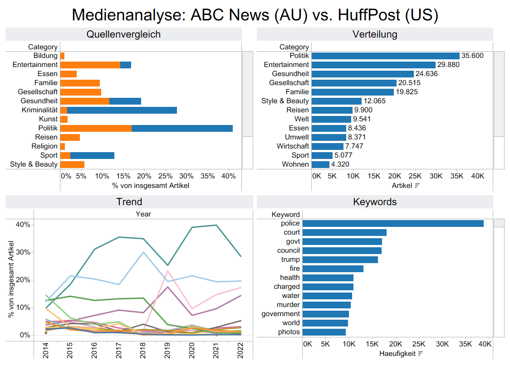

# Media Consumption Analysis — Content Strategy on a Data Foundation

> News content analysis for a marketing agency · **ABC News (AU)** & **HuffPost (US)**
> 1.45M headlines · 2 sources · 2003–2022 (20 years) · 6 key questions

A end-to-end analytics project: from two raw news datasets through a Python
processing pipeline to an interactive Tableau dashboard and a live web
dashboard. The goal — give a content-strategy team a data-backed view of which
topics matter, when, and how two very different newsrooms set their agenda.

---

## 🔗 Dashboard

*Static preview of the Tableau dashboard — **[open the live interactive version →](https://susannschmelzer29-lab.github.io/analytics-portfolio/07_media_consumption_analysis/dashboard/index.html)***

| | |
|---|---|
| **🖥️ Interactive dashboard (live)** | [View on GitHub Pages →](https://susannschmelzer29-lab.github.io/analytics-portfolio/07_media_consumption_analysis/dashboard/index.html) |
| **🖥️ Interactive dashboard (source)** | [`dashboard/`](dashboard/) — Chart.js build from `data/*.csv`, eight pages, one per key question |
 

---

## ❓ Key questions

1. **Distribution** — How do articles split across categories?
2. **Trend** — Which topics are most relevant over time?
3. **Seasonality** — Are there temporal patterns per category?
4. **Keywords** — Which terms dominate each category?
5. **Sources** — Which source/author focuses on which topic?
6. **Content length** — Do headline lengths differ by category?

---

## 🔑 Key findings

- **Two distinct editorial profiles.** In the categories both sources share
  (without "Other"), ABC News is **hard-news-driven** (crime 24.7 %, politics
  16.8 %, business 15.6 %), HuffPost leans towards **politics and service
  topics** (politics 30.9 %, health 21.7 %, society 19.4 %). Across all its own
  categories, HuffPost's largest are politics (17.6 %), health (12.2 %) and
  entertainment (11.3 %).
- **Politics rises at HuffPost from 2014** — from 9.8 % of articles in 2014 to
  35.5 % in 2017, the last year with more than 10,000 HuffPost articles. After
  2017 the dataset thins out sharply, so later values are not reliable.
- **Headlines are short, but not uniform.** ABC headlines run 6.4–7.2 words
  across categories, HuffPost headlines 8.2–10.7. The larger differences sit in
  the HuffPost *description* text: from about 15 words (food) to about 29
  (education).
- **Clear author specialisation** at HuffPost — 52 % of the 357 regular authors
  (≥ 100 articles) write at least 80 % of their articles in a single category.

---

## 🛠️ Method

1. **Ingest & clean** two datasets (ABC headlines; HuffPost headlines +
   descriptions + native categories).
2. **Categorise ABC** via keyword matching on headline text (ABC has no native
   labels).
3. **Aggregate** by source / year / month / category to keep the dashboard fast
   (< 250 KB inputs instead of > 70 MB raw).
4. **Harmonise** all category labels to one canonical vocabulary
   (see `00_kategorie_mapping.csv`).
5. **Visualise** — six Tableau worksheets, one per question, combined into a
   single interactive dashboard.

> **Transparency note:** ABC categories are keyword-derived; 67.7 % of ABC
> headlines remain **"Other"**, so ABC distribution figures describe the
> classified 32 %. The source comparison uses only the shared period and shared
> categories, normalised per source. Full detail in
> [`METHODOLOGY.md`](METHODOLOGY.md).

---

## 📁 Repository contents

| File | Purpose |
|---|---|
| `README.md` | This overview |
| `METHODOLOGY.md` | Canonical figures + methodological notes (DE & EN)
| `data/00_kategorie_mapping.csv` | Documents the label harmonisation |
| `data/01_tableau_aggregiert.csv` | Counts & word lengths per source/year/month/category |
| `data/02_tableau_keywords.csv` | Top keywords per category & source |
| `data/03_tableau_autoren.csv` | Articles per author & category (HuffPost) |
| `data/04_tableau_vergleich.csv` | Topic share ABC vs. HuffPost (shared categories) |
| `data/kategorie_summary.csv` | ABC category distribution summary |
| `data/VS_quellenvergleich.csv` | Source comparison (long form) |
| `dashboard/index.html` | Interactive dashboard (open in a browser or via GitHub Pages) |
| `dashboard/build_dashboard.py` | Builds `dashboard/data.js` from `data/*.csv` |
| `dashboard/test_dashboard.py` | Checks the dashboard figures against the source CSVs (runs in CI) |

---

## 🧰 Tools

Python (pandas) · Tableau Public · Chart.js

---

*Part of my [analytics portfolio](https://github.com/susannschmelzer29-lab/analytics-portfolio) — a résumé in projects.*
